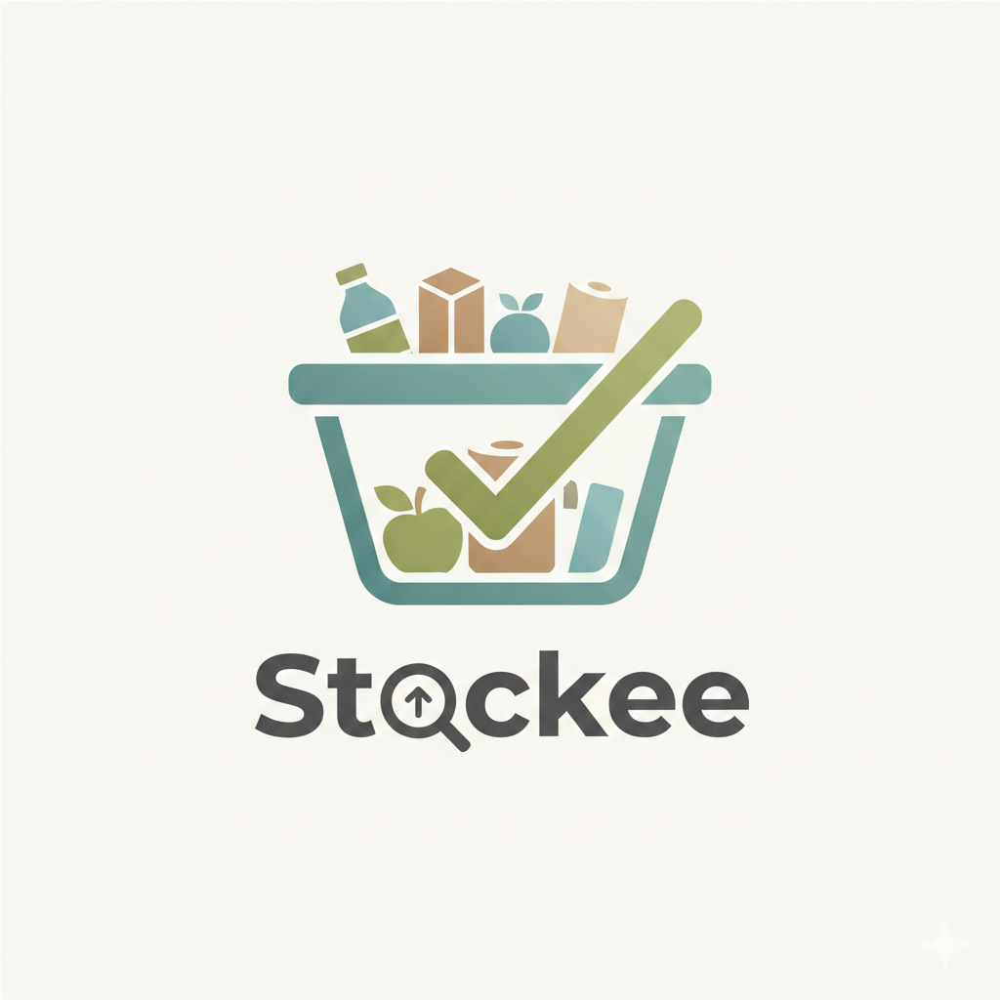

# 📦 Stockee - Smart Inventory Tracker

> Track your household inventory, get low-stock alerts, expiry reminders, and never overbuy again!



## 🎯 About

Stockee is a Progressive Web App (PWA) that helps you manage your personal inventory - whether it's toiletries, snacks, groceries, or cleaning supplies. No more overbuying what you already have or forgetting to restock what's running out!

### Why Stockee?

- 🛒 **Know what you have** - Clear overview of all your items
- ⚠️ **Low stock alerts** - Never run out of essentials
- 📅 **Expiry tracking** - Get reminders before items expire
- 💰 **Budget tracking** - See how much you spend per category
- ✈️ **Travel mode** - Auto-generate packing checklists
- 📱 **Works offline** - PWA with full offline support

## 🚀 Quick Start

### Prerequisites

- Node.js 18+ 
- npm or yarn or bun

### Installation

```bash
# Navigate to frontend
cd frontend

# Install dependencies
npm install

# Start development server
npm run dev
```

The app will be available at `http://localhost:8080`

### Build for Production

```bash
npm run build
npm run preview  # Preview production build
```

## 📁 Project Structure

```
src/
├── components/          # React components
│   ├── common/         # Shared components (ErrorBoundary, Loading, etc.)
│   ├── layout/         # Layout components (Header, BottomNav)
│   ├── inventory/      # Inventory feature components
│   ├── dashboard/      # Dashboard widgets
│   ├── charts/         # Chart components
│   └── ui/             # shadcn/ui base components
├── hooks/              # Custom React hooks
│   ├── useInventory.ts # Main inventory state management
│   ├── useLocalStorage.ts
│   ├── useOnlineStatus.ts
│   └── usePWA.ts       # PWA install/update handling
├── lib/                # Utilities
│   ├── constants.ts    # App constants & config
│   ├── formatters.ts   # Date/currency formatters
│   └── utils.ts        # Utility functions
├── pages/              # Page components (routes)
│   ├── Index.tsx       # Dashboard
│   ├── Inventory.tsx   # Inventory list
│   ├── ShoppingList.tsx
│   ├── ExpiryTracker.tsx
│   ├── TravelMode.tsx
│   ├── Wishlist.tsx
│   ├── Analytics.tsx
│   └── NotFound.tsx
├── services/           # API layer (for backend)
│   ├── api.ts          # Base API client
│   └── inventory.service.ts
├── types/              # TypeScript types
│   └── inventory.ts
├── data/               # Mock data
│   └── mockData.ts
├── App.tsx             # Main app component
├── main.tsx            # Entry point
└── index.css           # Global styles
```

## 🎨 Tech Stack

- **React 18** with TypeScript
- **Vite** for blazing fast builds
- **TailwindCSS** for styling
- **shadcn/ui** for UI components
- **React Router** for navigation
- **React Query** for data fetching
- **Recharts** for analytics charts
- **Vite PWA** for Progressive Web App

## 📱 PWA Features

Stockee is a fully-featured PWA with:

- ✅ **Installable** - Add to home screen on any device
- ✅ **Offline support** - Works without internet
- ✅ **App-like experience** - Full screen, splash screen
- ✅ **Auto-updates** - Get latest features automatically

### Installing on Your Device

1. Open Stockee in Chrome/Edge/Safari
2. Look for the "Install" prompt or menu option
3. Click "Install" or "Add to Home Screen"
4. Launch from your home screen!

## 🛠️ Development

### Available Scripts

| Script | Description |
|--------|-------------|
| `npm run dev` | Start dev server at :8080 |
| `npm run build` | Build for production |
| `npm run preview` | Preview production build |
| `npm run lint` | Run ESLint |

### Environment Variables

Create a `.env` file for custom configuration:

```env
# API URL (when backend is ready)
VITE_API_URL=http://localhost:3000/api
```

### Code Style

- **Components**: PascalCase (e.g., `ItemCard.tsx`)
- **Hooks**: camelCase with `use` prefix (e.g., `useInventory.ts`)
- **Utils**: camelCase (e.g., `formatDate`)
- **Types**: PascalCase (e.g., `InventoryItem`)

## 🔗 Backend Integration

The frontend is ready for backend integration! When your backend API is ready:

1. Set `VITE_API_URL` in `.env`
2. Use the services in `src/services/`
3. Replace localStorage calls in `useInventory.ts` with API calls

Example API endpoints expected:
- `GET /api/inventory` - List all items
- `POST /api/inventory` - Create item
- `PATCH /api/inventory/:id` - Update item
- `DELETE /api/inventory/:id` - Delete item

## 📄 License

This project is private.

## 👤 Author

**Syaqi** - Frontend Developer

---

Made with ❤️ for better inventory management
